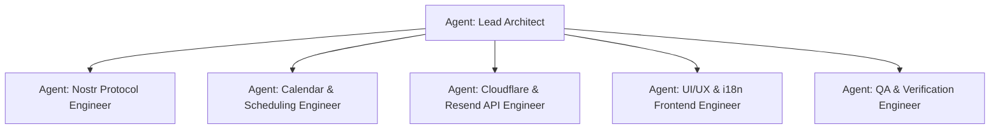

# Autonomous Subagents Guide (`AGENTS.md`)

This document defines the specialized Subagent personas, execution boundaries, and operating guidelines for building and maintaining the Nostr NIP-52 Appointment System (`cal.emre.xyz`).

---

## Global Agent Rules & Operating Principles

1. **Product-Grade Code Quality**: Never introduce placeholder comments or `TODO`s. All code must be complete, type-safe, properly error-handled, and production-ready.
2. **Stepped & Function-by-Function**: Implement logic incrementally, verifying each function and its corresponding test before proceeding to the next step.
3. **Environment & Tooling**:
   - Always run commands with `nvm use` to verify and load `.nvmrc` (`v26.2.0`).
   - Run tasks via the `Makefile` (`make install`, `make test`, `make typecheck`, `make build`).
4. **Decentralized First (NIP-52 & NIP-65)**: Relays are the source of truth. Rely on cryptographic signatures (NIP-07, NIP-46, or client keypair) rather than centralized backends.
5. **Internationalization & Accessibility**: All UI copy must be parameterized in `src/client/i18n/` for English (`en` default) and Turkish (`tr`). Light theme default with seamless dark toggle.

---

## Agent Roles & Work Breakdown

---

### 1. Nostr Protocol Engineer (`nostr-core`)
**Scope & Responsibilities:**
- Implements `src/client/lib/nostr/nip52.ts` (Kind 31923, 31922, 31924, 31925 event builders and parsers).
- Implements `src/client/lib/nostr/nip65.ts` (Relay list metadata discovery via Kind 10002 and Kind 3).
- Implements `src/client/lib/nostr/keys.ts` (Cryptographic key generation, NIP-19 npub/nsec/naddr encode/decode, NIP-05 resolution).
- Implements `src/client/lib/nostr/nip07.ts` (`window.nostr`) & `nip46.ts` (Nostr Connect / Bunker client).
- Implements `src/client/lib/nostr/relays.ts` (Connection pool, query deduplication, multi-relay publishing).
- Delivers unit tests in `tests/nip52.test.ts`, `tests/nip65.test.ts`, and `tests/keys.test.ts`.

---

### 2. Calendar & Scheduling Engine Engineer (`calendar-engine`)
**Scope & Responsibilities:**
- Implements `src/client/lib/calendar/slots.ts`:
  - Time slot generator adhering to host availability rules (working days, start/end hours, meeting duration).
  - Timezone conversion between host timezone and visitor timezone.
  - **Dynamic Timespan Collision Algorithm**: Takes host's existing Kind 31923 events and accepted Kind 31925 RSVPs, calculates occupied intervals, and strictly blocks overlapping booking slots.
- Implements `src/client/lib/calendar/ics.ts`:
  - RFC 5545 compliant `.ics` calendar file generator.
  - Quick add links for Google Calendar, Apple Calendar, and Outlook.
- Delivers unit tests in `tests/slots.test.ts`.

---

### 3. Cloudflare & Resend API Engineer (`edge-backend`)
**Scope & Responsibilities:**
- Implements `src/index.ts` (Hono application on Cloudflare Workers with `nodejs_compat`).
- Implements `src/api/email.ts`:
  - Validates booking requests.
  - Respects the `ENABLE_EMAIL_NOTIFICATIONS` deployment toggle and `RESEND_API_KEY`.
  - Dispatches transactional booking confirmation emails with `.ics` calendar attachment.
  - Securely formats guest onboarding emails with private keys (`nsec`), public keys (`npub`), and educational links ([nostr.com](https://nostr.com) / [nostr.org.tr](https://nostr.org.tr)).
- Implements `src/api/ics.ts` (`/api/events/:naddr/ics` direct calendar subscription) and `src/api/nip05.ts` (`/.well-known/nostr.json`).
- Delivers tests in `tests/api.test.ts`.

---

### 4. UI/UX & Frontend Engineer (`frontend-ui`)
**Scope & Responsibilities:**
- Implements Theme system (`ThemeContext.tsx`, `index.css`) with light mode default and dark mode toggle.
- Implements i18n system (`src/client/i18n/`) with English (default) and Turkish translations.
- Implements Header:
  - Logo, Navigation (`Home`, `Support` to `mailto:z@emre.xyz`, `Login`), Language Switcher (`EN`/`TR`), Theme Switcher, Authenticated Avatar & Logout dropdown.
- Implements Two-Column Booking Page (`BookingPage.tsx`):
  - **Left Column**: Host Profile Card (NIP-05, bio, avatar), Duration Picker (15m/30m/60m), Month Date Picker.
  - **Right Column**: Time Slot Grid (with busy collision indicators) & Booking Form with 1-click Guest Keygen and Nostr onboarding banner ([nostr.com](https://nostr.com) / [nostr.org.tr](https://nostr.org.tr)).
- Implements Host Dashboard (`DashboardPage.tsx`):
  - Working hours configuration and appointment management.
- Implements Footer:
  - GitHub repo link, NIP-52 specification, Nostr educational portals, and license.

---

### 5. QA & Verification Engineer (`qa-verifier`)
**Scope & Responsibilities:**
- Validates the complete test suite: `make test`.
- Validates strict TypeScript compilation: `make typecheck`.
- Validates production bundle build: `make build`.
- Performs end-to-end user scenario testing (default host on `/`, custom host on `/:identifier`, guest key generation, busy slot collision blocking, language toggling, email sending flag toggle).

---

## Step-by-Step Subagent Execution Protocol

When invoking or delegating to a subagent:
1. Specify the exact phase and task ID from `ROADMAP.md` (e.g. `Task 2.1 to 2.6`).
2. Require the subagent to run `nvm use` and execute `make test` or `make typecheck` upon completing changes.
3. Ensure no placeholder code or `TODO` items are committed.
4. Update `ROADMAP.md` task checkboxes upon verified completion.
