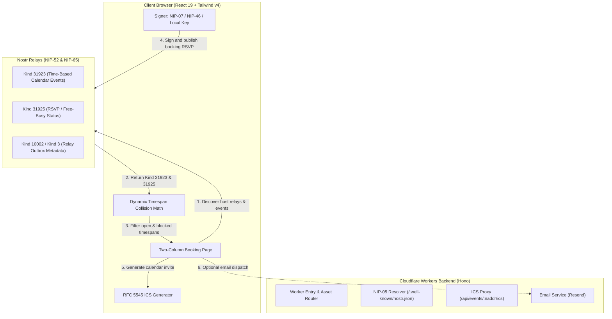

# cal.emre.xyz — Sovereign Nostr Scheduling System

[](https://opensource.org/licenses/MIT)
[](https://www.typescriptlang.org/)
[](https://workers.cloudflare.com/)
[](https://github.com/nostr-protocol/nips/blob/master/52.md)
[](https://vitest.dev/)

An open-source, decentralized calendar and appointment booking platform built on the [Nostr](https://nostr.com) protocol ([NIP-52](https://github.com/nostr-protocol/nips/blob/master/52.md)). Deployable globally to Cloudflare Workers with zero database dependencies.

---

## 🌟 Key Features

- ⚡ **Decentralized & Relay-Native**: Relays are the single source of truth. Appointments, availability, and RSVPs are published as cryptographic Nostr events.
- 🛡️ **Dynamic Collision Prevention Algorithm**: Reads host events (Kind `31923`) and accepted RSVPs (Kind `31925`) in real-time, calculating occupied timespans and strictly blocking double bookings.
- 🔑 **Sovereign Identity & 1-Click Guest Onboarding**:
  - Sign in with NIP-07 browser extensions (Alby, nos2x), NIP-46 Bunker (Nostr Connect), or local private keys.
  - Visitors without a Nostr account can generate an instant keypair (`npub`/`nsec`) with 1-click, paired with localized Nostr onboarding guides ([nostr.com](https://nostr.com) for English, [nostr.org.tr](https://nostr.org.tr) for Turkish).
- 📅 **Calendar Interoperability (RFC 5545)**:
  - Direct `.ics` file generation and download.
  - Direct web add links for **Google Calendar**, **Apple Calendar**, and **Microsoft Outlook / Office 365**.
  - Direct Cloudflare Worker subscription endpoint (`/api/events/:naddr/ics`).
- 🌐 **Internationalization (i18n)**:
  - English (`en` default) and Turkish (`tr`) with automatic browser language detection and persistent selector.
- 🎨 **Modern Responsive UI & Theming**:
  - Clean light-mode default with a seamless dark-mode toggle.
  - Built with React 19, Tailwind CSS v4, and Lucide icons.
- 📧 **Optional Transactional Emailing**:
  - Powered by [Resend](https://resend.com) with `.ics` calendar attachments.
  - Disabled by default (`ENABLE_EMAIL_NOTIFICATIONS=false`) for sovereign zero-backend setups.
- 🌍 **Edge Powered**:
  - Global edge execution via Cloudflare Workers and Hono with single-bundle client asset serving.

---

## 🏗️ Architecture Overview



---

## 📜 Supported Nostr Specifications (NIPs)

| NIP | Description | Implementation Details |
|---|---|---|
| **[NIP-52](https://github.com/nostr-protocol/nips/blob/master/52.md)** | Calendar Events | Kind `31923` (Time-based), Kind `31922` (Date-based), Kind `31925` (RSVPs with `busy`/`free` free-busy tags), Kind `31924` (Calendar Collections) |
| **[NIP-65](https://github.com/nostr-protocol/nips/blob/master/65.md)** | Relay List Metadata | Queries Kind `10002` and Kind `3` to dynamically discover host read/write outbox relays |
| **[NIP-07](https://github.com/nostr-protocol/nips/blob/master/07.md)** | Browser Extension Signer | Signs events via `window.nostr` |
| **[NIP-46](https://github.com/nostr-protocol/nips/blob/master/46.md)** | Nostr Connect / Bunker | Remote Bunker signing via relay transport |
| **[NIP-19](https://github.com/nostr-protocol/nips/blob/master/19.md)** | Bech32 Entities | `npub`, `nsec`, `naddr`, `note`, `nprofile` encoding and decoding |
| **[NIP-05](https://github.com/nostr-protocol/nips/blob/master/05.md)** | DNS Identifiers | NIP-05 resolution endpoint at `/.well-known/nostr.json` |

---

## 🚀 Quick Start

### Prerequisites
- Node.js `v26.2.0` (managed via `.nvmrc`)
- npm `v11.13.0` or higher
- GNU Make

### 1. Clone the Repository
```bash
git clone https://github.com/delirehberi/cal.emre.xyz.git
cd cal.emre.xyz
```

### 2. Switch Node Version & Install Dependencies
```bash
nvm use
make install
```

### 3. Start Local Development Server
```bash
make dev
```
Open your browser at `http://localhost:5173`.

---

## 🛠️ Configuration

Configuration is managed via `wrangler.jsonc` or local `.dev.vars`:

```bash
cp .env.example .dev.vars
```

### Environment Variables

| Variable | Description | Default | Required |
|---|---|---|---|
| `DEFAULT_HOST_NIP05` | Default host NIP-05 handle shown on `/` | `delirehberi@emre.xyz` | No |
| `DEFAULT_HOST_PUBKEY` | Default host hex public key | `46f3c7bb...` | Yes |
| `ENABLE_EMAIL_NOTIFICATIONS` | Toggle transactional email confirmations (`true` / `false`) | `false` | No |
| `RESEND_API_KEY` | Resend API key for sending confirmation emails | `""` | When email enabled |
| `SUPPORT_EMAIL` | Support contact email address | `z@emre.xyz` | No |

---

## 🧪 Testing & Code Quality

The project maintains 100% test pass rates and strict TypeScript compilation:

```bash
# Run unit and integration tests (Vitest)
make test

# Run tests in watch mode
make test-watch

# Run TypeScript strict type verification
make typecheck

# Build production bundle
make build
```

---

## 🚢 Deployment to Cloudflare Workers

### 1. Authenticate with Wrangler
```bash
npx wrangler login
```

### 2. Set Production Secrets (Optional)
If transactional emails are enabled:
```bash
npx wrangler secret put RESEND_API_KEY
```

### 3. Deploy Worker and Static Assets
```bash
make deploy
```

---

## 🤝 Contributing

Contributions are welcome! Please read [CONTRIBUTING.md](CONTRIBUTING.md) and [CODE_OF_CONDUCT.md](CODE_OF_CONDUCT.md) before opening pull requests.

To report security vulnerabilities, please refer to [SECURITY.md](SECURITY.md).

---

## 📄 License

This project is open-source software licensed under the [MIT License](LICENSE).

Designed & built by [Emre Yılmaz](https://emre.xyz) ([@delirehberi](https://github.com/delirehberi)) • Contact: `z@emre.xyz`.
